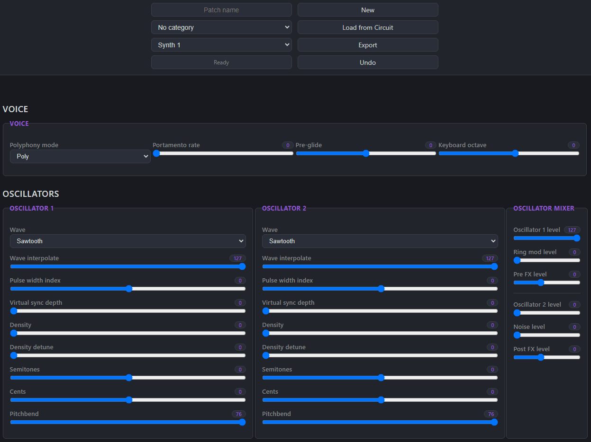

# Circuit Web Synth Editor

Circuit Web Synth Editor is a free/libre browser app for editing synth patches on the original Novation Circuit and Circuit Tracks. Circuit Rhythm and Circuit Mono Station are not supported.

The editor communicates with the instrument over USB MIDI. It can load a patch from the connected Circuit, edit its synth parameters, start a new patch, and export the result as a SysEx (`.syx`) file for use with Novation Components. Once the app is loaded, it can be used offline.

The project provides a browser-based alternative for GNU/Linux users who want to edit patches without relying on desktop software that may not be available on their system.



## Getting started

Open the [hosted app](https://mariawasnotavailable.github.io/circuit-web-synth-editor/) in a browser that supports the Web MIDI API. Chromium-based browsers are recommended. Connect a supported Circuit over USB and grant the browser MIDI access if prompted. The status in the navbar changes from **Waiting...** to **Connected** when the instrument is detected.

The app checks for a connected instrument after it starts, so you can plug it in after opening the page. If it is not detected, check the USB connection and browser MIDI access, then reload the page.

### Navbar

- **Patch name** and **category** set the patch metadata included in the exported SysEx file. Patch names are limited to 16 characters.
- **Synth 1 / Synth 2** selects which of the instrument's two synth parts you are editing.
- **Status** shows the MIDI connection state and editor feedback.
- **New** resets the controls to their default values after confirmation. If connected, the new settings are sent to the selected synth.
- **Load from Circuit** loads the patch currently selected on the instrument into the editor, after confirmation.
- **Export** downloads the patch currently shown in the editor as a `.syx` file.
- **Undo** reverses the most recent synth-parameter change.

## Build

To build from source, use Node.js 18.12 or newer:

```sh
npm ci
npm run build
```

The production build bundles and minifies the JavaScript and CSS with webpack. The deployable app is generated in `dist/`; it contains the built page, its assets, and a copy of the license. Deploy or distribute the contents of that directory. The source `index.html` remains in the repository.

## Deployment

Pushes to `master` build the app and publish `dist/` to the `circuit-web-synth-editor/` directory on the `main` branch of [MariaWasNotAvailable.github.io](https://github.com/MariaWasNotAvailable/MariaWasNotAvailable.github.io). The workflow uses the `PAGES_REPO_TOKEN` Actions secret to write to that repository.

## Troubleshooting

- Avoid running another editor or MIDI application connected to the Circuit while editing; competing MIDI messages can cause unwanted changes.
- If the instrument is not detected, confirm that it is a supported model, check the USB connection and browser MIDI access, and reload the app.
- If the Circuit freezes, unplug its USB cable.

## Libraries

The app uses the vendored [FileSaver.js](https://github.com/eligrey/FileSaver.js/) and [WebMidi.js](https://webmidijs.org/) libraries.

## Documentation

- [Novation Circuit documentation](https://downloads.novationmusic.com/novation/circuit/circuit)
- [Circuit Tracks Programmer's Reference Guide](https://downloads.novationmusic.com/novation/circuit/circuit-tracks)

## Disclaimer

This software is provided as-is. Use it at your own risk; the author is not liable for material damage, data loss, or other issues resulting from its use.

## License and attribution

This project is licensed under the GNU General Public License, version 3 or later; see [COPYING](COPYING). pumpkin/cgoehl authored the original project.
